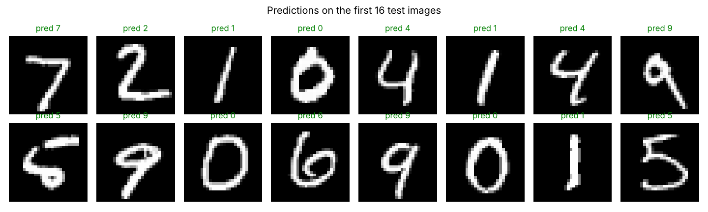
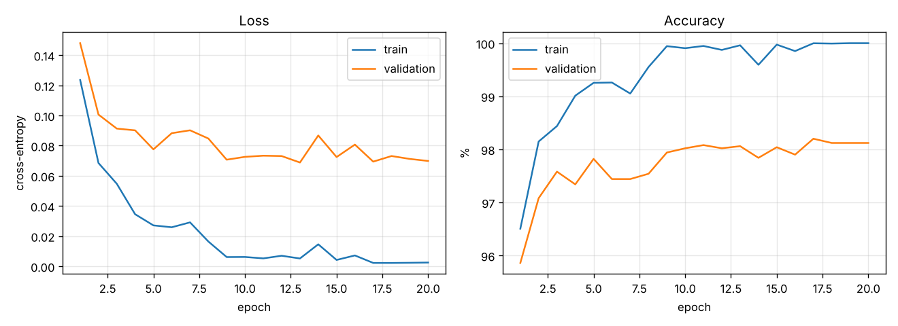
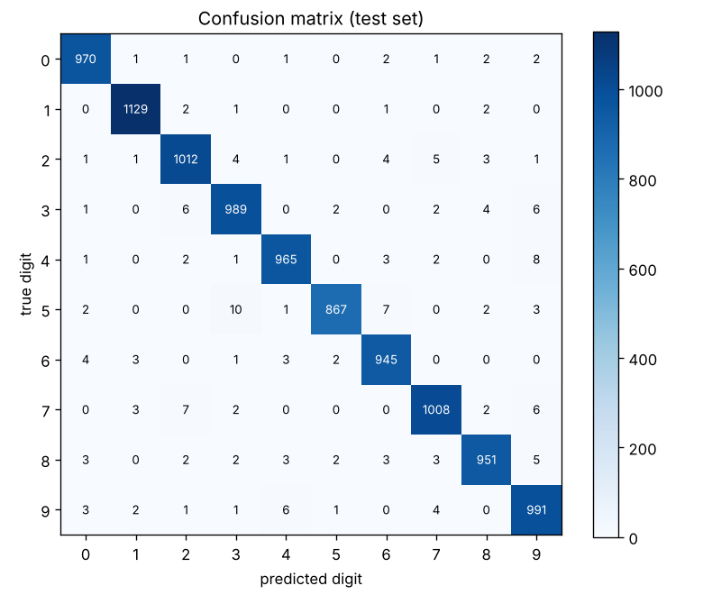

# MNIST Digit Recognition with an Artificial Neural Network (ANN)

A fully-connected neural network that recognises handwritten digits (0–9) from the
[MNIST dataset](https://en.wikipedia.org/wiki/MNIST_database), written **from scratch in
NumPy** — no TensorFlow or PyTorch — so every step (forward pass, backpropagation, the
Adam optimizer) is visible in one short file.

**Result: 98.27% accuracy on the 10,000 MNIST test images.**



## How it works

| Part | Choice |
|---|---|
| Input | 28×28 grayscale image flattened to 784 numbers, scaled to 0–1 |
| Hidden layer 1 | 256 neurons, ReLU activation |
| Hidden layer 2 | 128 neurons, ReLU activation |
| Output | 10 neurons, softmax (one probability per digit) |
| Loss | Cross-entropy, plus a small L2 weight decay (1e-4) |
| Optimizer | Adam, learning rate 0.001, halved every 8 epochs |
| Training | 20 epochs, mini-batches of 128 |
| Data split | 55,000 train / 5,000 validation / 10,000 test |

The model with the best validation accuracy is kept and then evaluated once on the test set.

## Results

| Metric | Value |
|---|---|
| Test accuracy | **98.27%** |
| Test loss | 0.0589 |
| Best validation accuracy | 98.20% |
| Training time | about 45 seconds on a laptop CPU |



The gap between the train and validation curves shows the network starts to memorise the
training set after about 10 epochs; keeping the best-validation weights limits the effect.



## Run it yourself

```bash
git clone https://github.com/jamal-uddin537/mnist-ann.git
cd mnist-ann
pip install -r requirements.txt
python mnist_ann.py
```

The script downloads MNIST (about 11 MB) into `data/` the first time, prints progress for
each epoch, and writes the plots, `metrics.json` and the trained weights to `results/`.
Change the settings at the top of `mnist_ann.py` (layer sizes, epochs, learning rate) to
experiment.

## Files

```
mnist_ann.py                     data loading, network, training and plots
requirements.txt                 numpy, matplotlib
results/metrics.json             final scores and per-epoch history
results/mnist_ann_weights.npz    trained weights (W0..W2, b0..b2)
results/*.png                    plots shown above
```

## Ideas for next steps

- Add dropout or data augmentation to narrow the train/validation gap
- Try a convolutional neural network (CNN), which usually reaches 99%+ on MNIST
- Train on [Fashion-MNIST](https://github.com/zalandoresearch/fashion-mnist), a harder drop-in replacement
